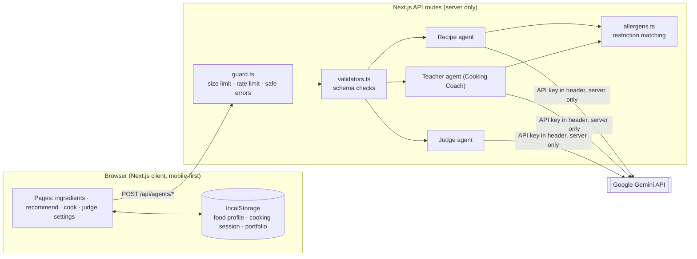
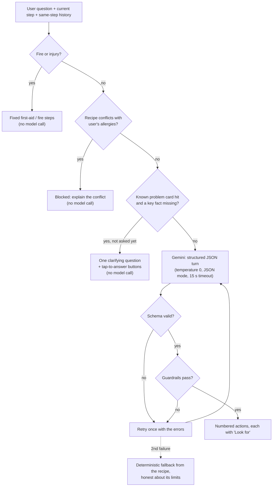

# Kuke — Technical Architecture

Kuke (酷嗑) is a mobile-first web app that walks a beginner cook through **choose → cook → review**.
Three independent AI agents cover the three moments a beginner gets stuck: what can I make, what do I do *right now*, and how did it turn out.

## System overview

- **Front end**: Next.js 15 App Router + React 19 + Tailwind, designed for a phone propped up in a kitchen.
- **AI proxy**: every model call goes through a Next.js API route. The Gemini key lives only on the server (`server-only` import guard; key sent in the `x-goog-api-key` header, never in the URL).
- **Shared context**: the three agents never call each other. They share one "cooking context" (the chosen recipe, its `finished_dish_standard`, and the session log) defined in `lib/data/types.ts`.
- **Storage**: currently the browser's `localStorage`. A server database is planned but not wired up.
- **Deployment target**: a single container on GCP Cloud Run (`Dockerfile`, `DEPLOY.md`). The deployment has not been run yet.

## API hardening (all agent routes)

| Route | Body limit | Rate limit (per instance) |
|---|---|---|
| `/api/agents/recipe` | 20 KB | 10 / min |
| `/api/agents/recipe/image` | 8 KB | 30 / min |
| `/api/agents/teacher` | 100 KB | 20 / min |
| `/api/agents/judge` | 4 MB (photo is resized to 1024 px on the client) | 6 / min |

`lib/api/guard.ts` rejects oversized bodies before reading them, rate-limits per client IP, and returns only messages we wrote ourselves. Raw model or stack errors go to the server log only. `lib/api/validators.ts` validates every field (types, lengths, counts) before anything reaches a prompt.

## The Cooking Coach (teacher agent)

The coach is the core of the product: a beginner asks a question mid-step, often with greasy hands. The design goal is **behaviour we can verify**, so the model is wrapped in deterministic layers and is never the only thing deciding what the user sees.

### Building blocks (`lib/agents/teacher/`)

| File | Role |
|---|---|
| `coach-types.ts` | The `CoachTurn` schema: `kind` (clarify / advise), `known`, `unknown`, at most one `clarifying_question`, ordered `actions` (each with `look_for`, optional heat and minutes), `safety_note`, `uncertainty_note`. Strict parser; history trimming that keeps the clarify exchange. |
| `triage.ts` | Knowledge cards for frequent beginner problems (sticking, burning, watery, too salty), with the one fact each needs (e.g. pan type for sticking), tap-to-answer options, and fixed fire and injury responses. |
| `guardrails.ts` | Deterministic checks on every model turn: answers the current step, doesn't push the user to a later step, doesn't claim to see the food, never suggests a restricted food, never promises food is "safe", and includes a reliable check (temperature or cut-open) when asked about meat doneness. |
| `doneness.ts` | Per-ingredient doneness checks (poultry 74 °C/165 °F, ground meat 71 °C/160 °F, …) that are added to the prompt and required by the guardrail. |
| `coach.ts` | The pipeline above. The model call is injected (`CoachDeps`), so the whole flow runs in tests with a scripted model. |
| `index.ts` | `respond()`: fire/injury first, then the allergy gate, then the coach. |

### Why this shape

- **The headline scenario is deterministic.** "My eggs are sticking" → the app asks which pan you use (the fix differs for non-stick and metal) with tap-to-answer buttons, in under a second and without calling the model. Only after the answer does Gemini write tailored steps, grounded in the knowledge card.
- **Safety-critical paths never depend on the model.** Fire, injury and allergy conflicts are handled by fixed code.
- **Model output is a contract, not prose.** A malformed or rule-breaking turn is retried once with the exact problems listed, then replaced by a fallback. It is never shown half-finished.

## Allergy and diet restrictions (`lib/safety/allergens.ts`)

Free-text restrictions from settings ("peanut", "海鮮", "vegetarian") are mapped to ingredient vocabularies in English and Chinese. They are used in three places:
1. **Recommendations**: conflicting recipes are filtered out.
2. **Cook page**: all findings (conflicts and "check the label" items) before starting; clear conflicts again on every step, so users who resume mid-way still see them.
3. **Coach**: a conflicting recipe is blocked, the restriction is a hard rule in the prompt, and a guardrail rejects any reply that suggests the food. Warnings such as "check the label is peanut-free" are allowed.

## Judge agent

Gemini Vision scores the finished-dish photo against the recipe's own `finished_dish_standard` on three 1–5 dimensions, each with evidence. Taste, internal doneness and food safety are explicitly out of scope, because a photo can't show them. It uses temperature 0, JSON mode, and one retry on unusable output. Unclear photos get a retake request instead of a score.

## Evaluation and testing

- **Vitest**: ~540 unit and flow tests, including a fixed 21-case evaluation that runs through the real `respond()` with a scripted model (`tests/eval/`).
- **Real-model evaluation**: `node scripts/eval-coach.mjs --runs N` runs the same cases against Gemini and records every model output, its format result and its guardrail result. Results and their limits are in [`docs/eval/report.md`](../eval/report.md).
